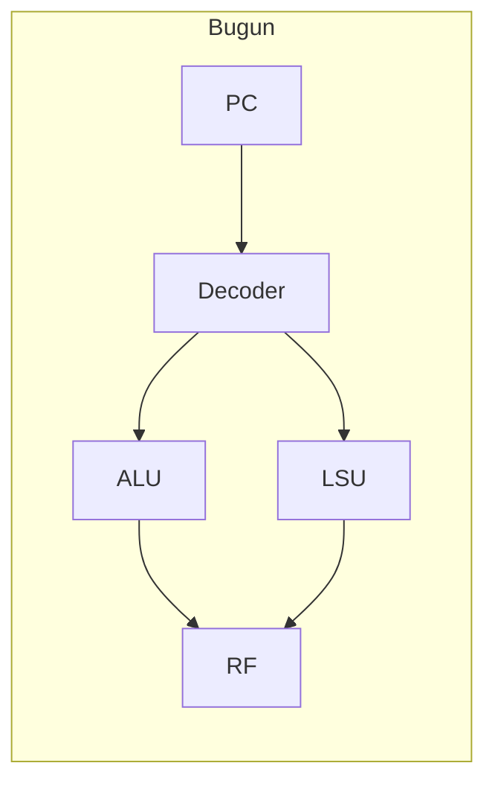
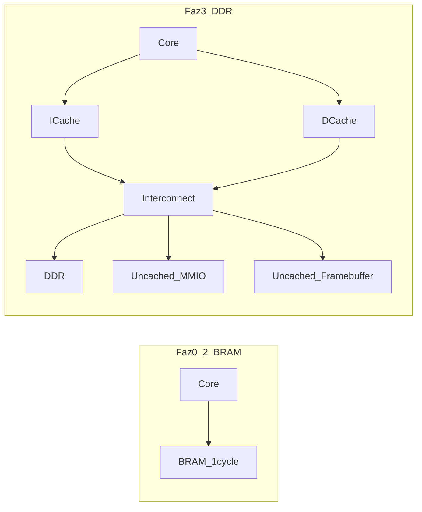
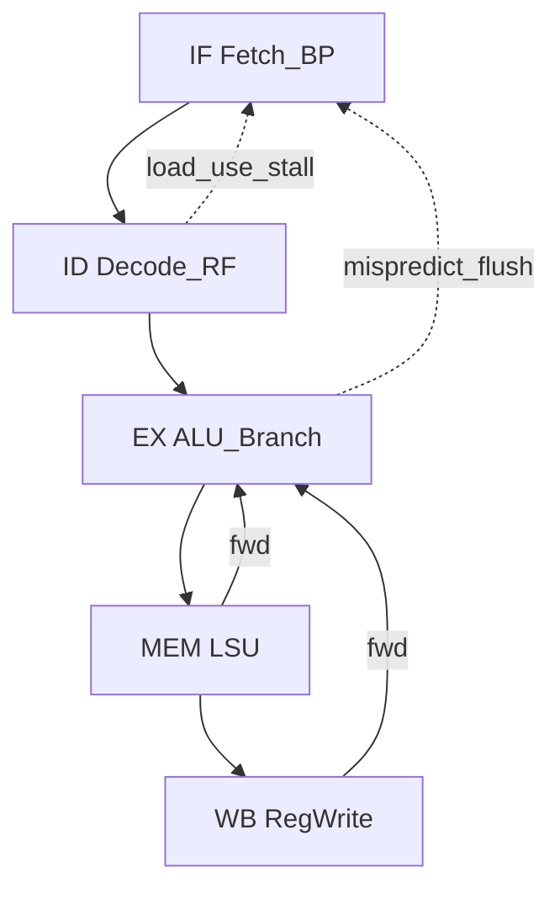
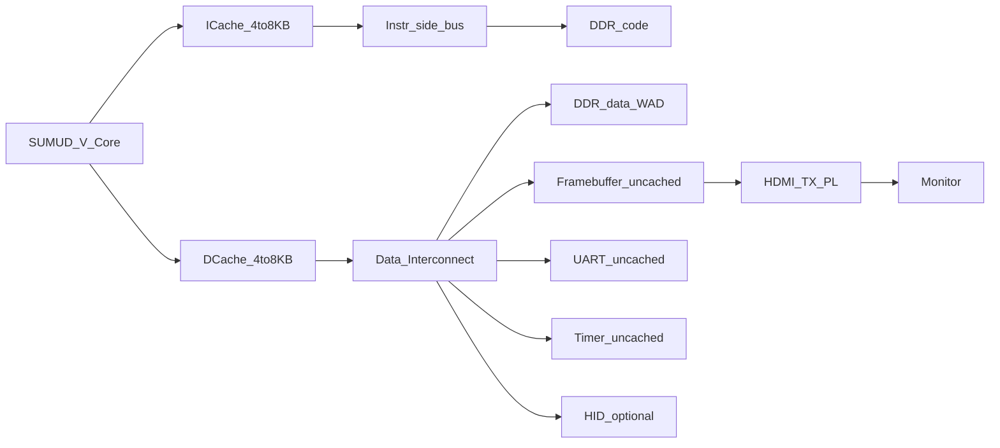
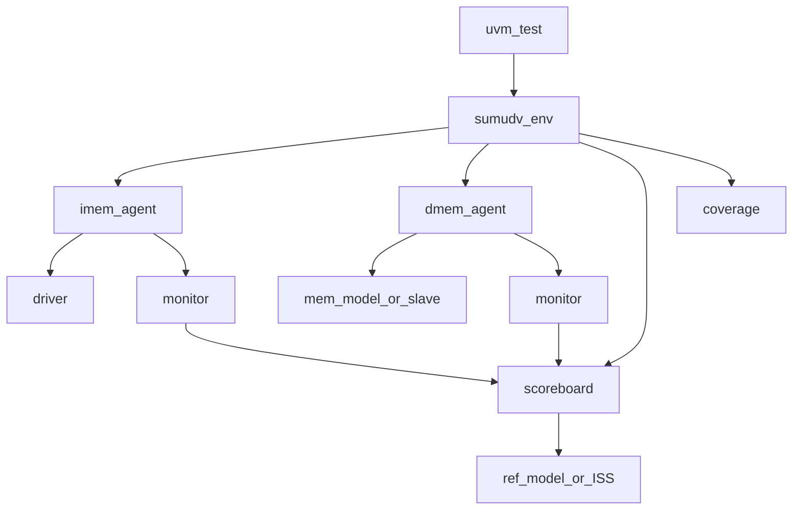
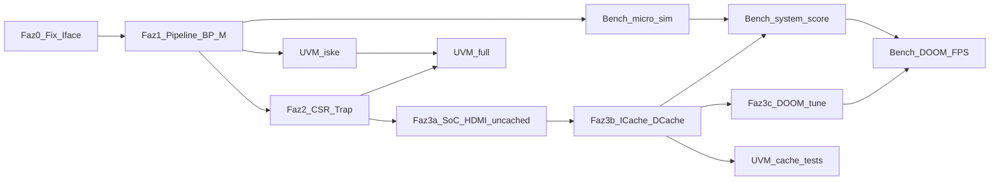

# SUMUD-V: Pipeline → Zybo/HDMI/DOOM → UVM Yol Haritası

Fazlı proje planı: tek çevrimli RV32I çekirdeği 5-aşamalı in-order pipeline’a dönüştürmek, Zybo Z7-20 üzerinde HDMI/DOOM SoC kurmak, sıfırdan UVM ortamı oluşturmak ve ölçülebilir benchmark suite ile performans skoru üretmek.

---

## Mevcut durum (özet)

| Alan | Bugün |
|------|--------|
| Mikro Mimari | Tek çevrim: combo decode/ALU/LSU + FF ile PC/RF ([`rtl/core.sv`](../rtl/core.sv)) |
| ISA | RV32I integer path çalışıyor; CSR/SYSTEM/FENCE decode var, execute yok ([`includes/riscv.svh`](../includes/riscv.svh), [`rtl/decoder.sv`](../rtl/decoder.sv)) |
| Bellek | Harvard I/D portları; **ready/valid yok**; store adresi `rs1` (imm eklenmiyor — bug). Port yorumları “L1 cache” diyor ama **cache RTL yok** — çıplak bellek arayüzü |
| Hazard / BP | Yok; `rs1_used`/`rs2_used` sadece decode’da işaretli |
| Cache | Yok (tasarım Faz 3’te, DDR’a çıkınca) |
| SoC / HDMI | Repo’da yok |
| DV | Tek prosedürel [`dv/tb_top.sv`](../dv/tb_top.sv); UVM yok; sim: ModelSim via [`work/Makefile`](../work/Makefile) |



## Varsayımlar (bu planda sabitlenenler)

- **ISA hedefi:** RV32IM + Zicsr + M-mode (DOOM için `mul` şart; trap/timer için CSR şart).
- **Pipeline:** Klasik **5-stage in-order**: IF → ID → EX → MEM → WB.
- **Branch predictor (ilk sürüm):** BTB + 2-bit saturating counter; mispredict’te EX’ten flush.
- **Klavye/mouse:** Bu planda zorunlu değil; USB HID veya PS/2 PS üzerinden ayrı faz olarak işaretlenecek.
- **UVM:** Çekirdek pipeline + bellek handshake stabilize olduktan sonra sıfırdan kurulacak; ara dönemde mevcut TB genişletilerek smoke korunacak.
- **FPGA:** Xilinx Zybo Z7-20; soft-core PL’de; framebuffer DDR’da; HDMI TX PL IP ile.
- **Cache:** Evet, tasarlanacak — ama **pipeline’dan sonra**, DDR bellek yoluna geçildiğinde. Erken fazlarda BRAM ile 0–1 cycle bellek; cache yok.
- **Benchmark:** Faz 5’te sabit suite + skor kartı; her mikro mimari iyileştirmede (BP, M, cache) aynı suite ile delta ölçülür.

---

## Cache stratejisi (IMEM / DMEM)

### Cache tasarlanacak mı?

**Evet — ama şartlı ve fazlı.**

| Evre | Bellek arkası | Cache? |
|------|---------------|--------|
| Faz 0–2 (sim + BRAM bring-up) | On-chip BRAM (~1 cycle) | **Hayır** — hit oranı zaten “her erişim hit”; karmaşıklık boşa |
| Faz 3 (Zybo + DDR + DOOM) | DDR (onlarca–yüzlerce cycle) | **Evet** — yoksa CPU çoğu zaman bellekte bekler; DOOM oynanamaz |

Özet: Cache, pipeline’ın parçası değil; **yavaş bellek (DDR) ile hızlı çekirdek arasındaki köprü**. `core` portlarındaki “L1 cache port” yorumu tam olarak bu katmana hazırlık: önce handshake’li core↔mem arayüzü, sonra araya `icache` / `dcache` modülleri.



### FPGA’de cache mantıklı mı?

**Evet — soft-core + DDR senaryosunda neredeyse zorunlu.**

- Zybo Z7-20’de anlamlı boyutta kod/WAD/framebuffer **DDR’da** yaşar; PL BRAM kapasitesi DOOM için yetmez.
- FPGA BRAM/URAM, tag+data array için doğal ve ucuz; soft CPU’larda (VexRiscv, MicroBlaze, vb.) L1 cache standarttır.
- Cache **olmadan** DDR’a her fetch/load = uzun stall → IPC çöker.
- Cache **yanlış yerde** (MMIO / framebuffer’ı cache’lemek) ise tutarsızlık ve görüntü artefaktı üretir — bu yüzden **bölgesel (address-based) cacheability** şart.

Ne zaman mantıklı değil: Sadece küçük demo, her şey BRAM’de, tek çevrim bellek. O aşamada cache eklemek erken optimizasyon.

### Önerilen yapı (bu proje için sabit seçim)

Hedef: DOOM için yeterli hit rate, FPGA’de sentezlenebilir, doğrulanabilir sadelik. Fully-associative / MESI / L2 **yok**.

#### I-Cache (IMEM yolu)

| Özellik | Seçim | Gerekçe |
|---------|--------|---------|
| Tip | Ayrı I$ (Harvard) | Fetch’i load/store’dan ayırır; DOOM’da kod stream yoğun |
| Organizasyon | **2-way set-associative** | Direct-mapped’e göre conflict miss azalır; 4-way FPGA timing/BRAM maliyetine pahalı |
| Boyut | **4–8 KiB** | BRAM bütçesi + tipik bare-metal kod çalışma kümesi |
| Line | **32 byte** (8 instruction) | DDR burst ile uyumlu; miss’te sequential fill |
| Replacement | **LRU (2-way = 1 bit)** | Basit ve yeterli |
| Yazma | Read-only; store ile invalidate gerekmez (self-modifying yok) | DOOM bare-metal’de I-side yazılmaz |
| Hit latency | 1 cycle (pipeline IF ile örtüşür) | |
| Miss | Line fill + core stall (`!rvalid`) | Core’daki mem handshake ile doğal bağlanır |

`FENCE.I` gelirse: I$ flush/invalidate — Faz 2 CSR ile birlikte düşünülür; DOOM için nadiren kritik.

#### D-Cache (DMEM yolu)

| Özellik | Seçim | Gerekçe |
|---------|--------|---------|
| Organizasyon | **2-way set-associative**, **4–8 KiB**, **32 B line** | I$ ile aynı “aile”; tasarım/reuse kolay |
| Yazma politikası | **Write-through + no-write-allocate** (ilk sürüm) | Write-back’ten çok daha basit doğrulama; FPGA getiriminde güvenli |
| İyileştirme (sonra) | Write-back + write-allocate | Stack/heap yoğun bölgelerde bant genişliği kazanır; karmaşıklık artar |
| MMIO | **Uncached** (adres decode) | UART/timer/GPIO — cache’lenmez |
| Framebuffer | **Uncached** (veya write-buffer only) | HDMI DMA/scanout ile tutarlılık; CPU pixel yazıları bypass |
| WAD / heap / stack | Cached | DOOM performansının asıl kaynağı |
| Coherence | Tek master CPU (+ ayrı video read portu FB’ye) | SMP yok; tek core → snooping gerekmez |

Write-through seçilmesinin nedeni: İlk doğru çalışan SoC + UVM skorboard için store görünürlüğü basit kalır. DOOM profiling sonrası stack/WAD darboğazı netleşirse D$ write-back’e yükseltilir — API (core↔cache handshake) değişmez.

### Neden bu yapı “daha performanslı / verimli”?

| Alternatif | Bu proje için değerlendirme |
|------------|-----------------------------|
| Cache yok, her şey DDR | En basit; DOOM için **yetersiz** |
| Sadece I$, D$ yok | Kod hızlanır; oyun state/WAD hâlâ DDR’da ölür — **yarım çözüm** |
| Direct-mapped 2–4 KiB | En az LUT/BRAM; conflict miss DOOM’da can sıkar — getirim için OK, hedef değil |
| **2-way 4–8 KiB I$+D$ (seçilen)** | Maliyet/performans dengesi; FPGA soft-core pratiğiyle uyumlu |
| 4-way / 32 KiB / L2 | Marjinal FPS vs ciddi doğrulama ve timing maliyeti — kapsam dışı |
| Unified L1 | Tek port çakışması (fetch vs load); in-order Harvard’da ayrı I$/D$ daha temiz |

DOOM özelinde: instruction locality yüksek → I$ hit rate iyi; veri tarafında WAD + renderer working set D$’ye sığmalı. Framebuffer’ı cache’lemek genelde **zararlı** (büyük, streaming, side-reader).

### Core ile bağlantı

- Core yalnızca **handshake’li mem portu** görür (`req/gnt/rvalid`); arkasında BRAM mı cache mi olduğunu bilmez.
- Cache miss = uzun stall; hazard unit zaten mem stall’ı desteklemeli (Faz 1).
- `FENCE` / uncached region’lar adres map’ten `cacheable` bitine bağlanır.

### Cache doğrulama (UVM’e bağ)

- Ayrı `icache` / `dcache` unit test + sonra full-chip: random cacheable traffic, MMIO uncached assert, line-fill vs hit scoreboard.
- Ref model: “architectural memory” (cache-transparent); timing değil fonksiyonel tutarlılık.

### Ne zaman yapılır? (faz yerleşimi)

1. **Faz 0–1:** Cache yok; BRAM / ideal mem model.
2. **Faz 3a (SoC):** Önce uncached DDR (doğru ama yavaş) — getiri.
3. **Faz 3b:** I$ + D$ ekle; FB/MMIO uncached kalsın.
4. **Faz 3c (opsiyonel):** D$ write-back; line size / boyut tune; performans sayaçları (`hpmcounter` miss/hit).

---

## Faz 0 — Temel düzeltmeler ve arayüz sözleşmesi (1–2 hafta)

Pipeline’a geçmeden önce çekirdek “doğru ve bağlanabilir” hale gelmeli.

1. **Store adresi bug’ını düzelt:** `data_addr_o = rs1_data + immediate` (load ile aynı).
2. **Modülerleştirme (ayrı dosyalar, lowRISC stil):**
   - `regfile.sv`, `alu.sv`, `lsu.sv`, `pc_gen.sv` — mantık [`core.sv`](../rtl/core.sv)’den taşınır; `decoder.sv` korunur.
3. **Bellek protokolü (zorunlu):** IMEM ve DMEM için `req` / `gnt` (veya `valid`/`ready`) + `rvalid` ekle. Tek çevrim TB önce 0-latency grant ile uyumlu kalsın; pipeline stall bu sinyallere bağlanacak.
4. **`instr_t` genişletmesi** ([`includes/riscv.svh`](../includes/riscv.svh)): `valid`, `is_branch`, `is_jump`, `rd_used`, exception flags — stage register taşıma için.
5. **Smoke TB’yi koru:** [`dv/tb_top.sv`](../dv/tb_top.sv) yeni portlara uyarlanır; R-type assert’leri tamamlanır; `make gui` bug’ı düzeltilir (`GUI=1`).

**Çıkış kriteri:** Mevcut directed testler yeşil; store offset doğru; bellek handshake simüle edilebiliyor.

---

## Faz 1 — 5-stage in-order pipeline + hazard (çekirdek)



### 1.1 Stage register’lar

Yeni RTL (önerilen ağaç):

```
rtl/
  core.sv          # top + pipeline glue
  if_stage.sv
  id_stage.sv
  ex_stage.sv
  mem_stage.sv
  wb_stage.sv
  hazard_unit.sv
  forward_unit.sv
  branch_predictor.sv
  btb.sv
  muldiv.sv        # Faz 1.4
  csr_file.sv      # Faz 2
  icache.sv        # Faz 3b
  dcache.sv        # Faz 3b
  cache_pkg.sv     # line/tag parametreleri
```

Her pipe register `instr_t` + operand/result alanlarını taşır; `valid` bit flush/stall ile yönetilir.

### 1.2 Hazard & forwarding

| Durum | Çözüm |
|-------|--------|
| RAW (EX/MEM/WB → ID/EX) | Forwarding: EX→EX, MEM→EX (ve gerekirse WB→ID) |
| Load-use | 1 cycle stall (`hazard_unit`: ID rs ↔ MEM load rd) |
| Control hazard | Predict IF’te; resolve EX’te; mispredict → IF/ID flush, PC redirect |
| Memory stall | IMEM/DMEM `!gnt` / `!rvalid` → ilgili stage’leri dondur |

`decoder` içindeki `rs1_used`/`rs2_used` hazard biriminde tüketilecek (şu an ölü alan).

### 1.3 Branch predictor

- **BTB:** PC tag + target; hit → predicted next PC.
- **Direction:** 2-bit saturating; BTB miss’te static BTFN (backward taken).
- **JAL:** BTB veya decode-time erken redirect (ID) opsiyonel iyileştirme.
- **JALR:** İlk sürümde predict etme / BTB-only; mispredict maliyeti kabul.

Performans sayaçları (CSR veya debug): `bp_hits`, `bp_misses`, `stall_cycles` — hem FPGA hem UVM için faydalı.

### 1.4 M extension

- `muldiv.sv`: multi-cycle (ör. 1-cycle mul DSP, iterative div) veya sabit latency; pipeline’ı `busy` ile stall et.
- Decode’a `MUL`/`DIV`/`REM` op’ları; [`operation_t`](../includes/riscv.svh) genişletilir.

### 1.5 Doğrulama (pipeline dönemi — UVM öncesi)

- Directed hazard suite: load-use, back-to-back ALU, branch mispredict pairs.
- Küçük bellek modeli TB içinde (IMEM array + DMEM array).
- İsteğe bağlı: riscv-tests (`rv32ui-*`, sonra `rv32um-*`) binary yükleme.

**Çıkış kriteri:** RV32I (+ temel M) programları pipeline’da doğru; load-use ve branch flush edge-case’leri geçiyor.

---

## Faz 2 — Privilege / CSR / trap (DOOM ve bare-metal için)

[`riscv.svh`](../includes/riscv.svh) zaten `mstatus`/`mcause`/`mip`/`mie` tiplerini tanımlıyor; RTL’de execute yok.

Minimum M-mode seti:

- `mstatus`, `mtvec`, `mepc`, `mcause`, `mtval`, `mie`/`mip`, `mscratch`
- `mcycle`/`minstret` (+ opsiyonel `mhpm*`)
- `ecall` / `ebreak` / illegal → trap; `mret`
- Timer: `mtime`/`mtimecmp` memory-mapped veya özel CSR (mevcut `MTIMECMP` enum’u kullanılabilir)
- `MACHINE_MODE` define’ını [`work/Makefile`](../work/Makefile) / `files.f` ile aç

Interrupt: timer + harici (HDMI/VSYNC veya UART) için `mip.meip` hattı SoC’tan gelecek.

**Çıkış kriteri:** Trap/mret + timer interrupt ile basit bare-metal “hello” / blink.

---

## Faz 3 — Zybo Z7-20 SoC ve HDMI (DOOM getirisi)



Getirim sırası: önce cache’siz DDR (3a) → I$/D$ (3b). Detaylı organizasyon için yukarıdaki **Cache stratejisi** bölümüne bak.

### 3.1 Bus ve bellek haritası (öneri)

| Bölge | İçerik |
|-------|--------|
| `0x8000_0000` | Boot / kod — **cacheable** (önce BRAM, sonra DDR+I$) |
| `0x8001_0000+` | DMEM / heap / WAD — **cacheable** (D$) |
| `0x1000_0000` | MMIO: UART, timer, GPIO — **uncached** |
| `0x2000_0000` | Framebuffer — **uncached** (HDMI scanout ile tutarlı) |

İlk getirim: basit **Wishbone veya AXI-Lite** slave’ler; core tarafında mevcut req/gnt’yi bus adaptörüne bağla. Zybo’da DDR için Zynq PS HP port + PL soft-core klasik yol; alternatif: tamamen PL + MIG (daha ağır).

**Öneri (pratiklik):** Zynq PS’i yalnızca DDR (+ ileride USB HID) için kullan; RISC-V tamamen PL’de kalsın. HDMI timing PL’de Digilent/Xilinx TMDS IP veya açık kaynak HDMI TX.

### 3.2 Video yolu

1. Sabit renk / renk çubuğu (HDMI bring-up).
2. CPU ile framebuffer’a pixel yazma.
3. 320×200 (DOOM native) → HDMI 640×480 scaler (nearest-neighbor).
4. VSYNC/HSYNC’e göre tear azaltma (double buffer opsiyonel).

### 3.3 Yazılım yığını

- Toolchain: `riscv32-unknown-elf-gcc`, bare-metal linker script (`BootAddr`).
- `doomgeneric` veya benzeri RISC-V bare-metal port; WAD DDR’da.
- Performans: ~50–100 MHz in-order RV32IM ile yazılım render mümkün; M extension, BP ve **DDR üzerinde I$/D$** kritik. Cache yoksa FPS büyük ölçüde bellek gecikmesine gömülür.

### 3.4 Klavye / mouse (ayrı tartışma — bu fazda opsiyonel)

| Yol | Not |
|-----|-----|
| PS/2 PMOD | PL’de basit; DOOM için yeterli |
| USB HID via Zynq PS | Daha gerçekçi; PS↔PL mailbox gerekir |
| UART’tan tuş emülasyonu | Getirim için en hızlı |

**Çıkış kriteri:** Monitörde framebuffer; en azından demo frame / basit renderer; ardından DOOM main loop.

---

## Faz 4 — Sıfırdan UVM ortamı (verification skill odaklı)

Hedef: “istediğim testi uygulayayım” + skill geliştirme. Mimari eğitim-dostu, katmanlı olacak.



### 4.1 Dizin yapısı (hedef)

```
dv/
  tb/tb_top.sv              # clock, DUT, vif binding; uvm_pkg
  interfaces/
    imem_if.sv
    dmem_if.sv
  agent/
    imem_*/ dmem_*/
  env/
    sumudv_env.sv
    scoreboard.sv
    ref_model.sv            # önce SV golden; sonra Spike DPI opsiyonel
  seq/
    base_seq.sv
    hazard_seq.sv
    branch_seq.sv
    random_instr_seq.sv
  tests/
    smoke_test.sv
    hazard_test.sv
    bp_test.sv
    random_test.sv
    riscv_compliance_test.sv
  cov/
    instr_cg.sv
  cfg/
    *.json                  # generate_sv_from_json.py buraya bağlanır
work/
  Makefile                  # UVM_HOME, +UVM_TESTNAME, seed, coverage
```

Mevcut stub [`work/generate_sv_from_json.py`](../work/generate_sv_from_json.py) → `dv/cfg/*.json` → `dv/env/config_auto.svh` olacak şekilde düzeltilir.

### 4.2 Skill sırası (bilinçli öğrenme yolu)

1. Interface + driver + monitor + sequence (IMEM fetch’i agent sürsün).
2. Slave mem model (DMEM agent) + scoreboard (transaction-level).
3. Reference model: önce instruction-accurate SV model; olgunlaşınca Spike DPI-C.
4. Functional coverage: opcode, hazard türleri, BP hit/miss, CSR/trap.
5. Constrained-random + directed regression; plusargs ile test seçimi.

### 4.3 Araç

- Birincil: **Questa/ModelSim** (mevcut `vsim` akışı).
- UVM 1.2 / IEEE 1800.2; `+UVM_TESTNAME=...`.

**Çıkış kriteri:** En az 4 ayrı test class; scoreboard’suz smoke yok; coverage raporu üretilebiliyor; pipeline hazard testleri UVM sequence ile koşuyor.

---

## Faz 5 — Benchmark suite ve skor kartı

Amaç: “daha hızlı oldu” hissi yerine **tekrarlanabilir, karşılaştırılabilir skor**. Her önemli RTL değişikliğinde (forwarding, BP, M, cache, frekans) aynı suite koşulur; sonuçlar `bench/results/` altına kaydedilir.

### 5.1 Ne zaman koşulur?

| Katman | Ortam | Ne zaman |
|--------|--------|----------|
| Micro-bench (A) | Simülasyon (ideal/BRAM mem) | Faz 1 sonrası; her pipeline/BP değişikliğinde |
| System-bench (B) | Sim veya FPGA (DDR±cache) | Faz 3a/3b sonrası |
| App-bench (C) | FPGA (HDMI) | Faz 3c DOOM getirimi sonrası |
| Full scorecard | Hepsi birlikte | Release / milestone kapısı |

Mikro skorlar erken gelir; **resmi SUMUD-V skoru** B+C metriklerini de içerir (DDR gerçekçiliği olmadan DOOM skoru anlamsız).

### 5.2 Benchmark suite içeriği

```
sw/                      # tüm bare-metal yazılım (apps + benches)
  dhrystone/ coremark_eembc/ mem_latency/ branch_torture/ mul_heavy/ doom/ …
bench/                   # sadece skor altyapısı (ikinci bir sw/ yok)
  scripts/               # run_sim_bench.sh, score.py
  results/               # <git-sha>_<config>.json
  SCORECARD.md
third_party/             # coremark, doomgeneric submodules
```

| Suite | Ölçülen | Birim |
|-------|---------|--------|
| **Dhrystone** | Integer throughput | DMIPS, DMIPS/MHz |
| **CoreMark** (veya Embench) | Genel gömülü skor | CoreMark, CoreMark/MHz |
| **mem_latency** | Effective memory stall | avg cycles/access, bandwidth MB/s |
| **branch_torture** | BP kalitesi | mispredict %, IPC |
| **mul_heavy** | M extension | cycles vs soft-mul baseline |
| **DOOM** | Uygulama | ortalama FPS, frame time p99, sabit demo’da total cycles |

### 5.3 Donanım sayaçları (skor altyapısı)

Faz 2 CSR’lerine bağlanan performans sayaçları (minimum):

- `mcycle`, `minstret` → **IPC = minstret/mcycle**, **CPI = 1/IPC**
- `hpmcounter*`: I$ hit/miss, D$ hit/miss, BP hit/miss, load-use stall cycles, mem stall cycles, flush cycles

Simülasyonda aynı sayaçlar; FPGA’da UART üzerinden dump veya bellek-map `PERF_STATUS` register.

### 5.4 Skor modeli (tek sayı + alt kırılım)

Ham metrikler normalize edilip **SUMUD-V Score (0–100)** üretilir. Ağırlıklar (sabit varsayılan):

| Bileşen | Ağırlık | Normalize referans (hedef = 100 alt puan) |
|---------|---------|------------------------------------------|
| CoreMark/MHz | 25% | örn. 2.5 CoreMark/MHz @ BRAM ideal |
| DMIPS/MHz | 15% | örn. 1.0 DMIPS/MHz |
| IPC (mix workload) | 15% | örn. 0.70 IPC |
| BP accuracy | 10% | örn. ≥90% doğru predict |
| I$ hit rate (DDR config) | 10% | örn. ≥95% |
| D$ hit rate (cacheable) | 10% | örn. ≥90% |
| DOOM FPS @ 640×480 scale | 15% | örn. 15 FPS = 100 alt puan (hedef oynanabilirlik) |

`score.py` formülü (özet):

```text
component = min(100, 100 * measured / target)
SUMUD_V_Score = Σ (weight_i * component_i)
```

Konfig etiketleri ayrı skor satırı üretir — tek skorla karıştırılmaz:

- `sim-bram-ideal`
- `fpga-ddr-uncached`
- `fpga-ddr-cached`  ← **birincil karşılaştırma satırı**
- `fpga-doom`

Her sonuç JSON’unda: git SHA, fmax (MHz), cache on/off, BP tipi, tarih.

### 5.5 Karşılaştırma disiplini (A/B)

Her iyileştirme PR/milestone’unda zorunlu tablo:

| Config | Score | IPC | CM/MHz | I$hit | D$hit | BP% | DOOM FPS |
|--------|-------|-----|--------|-------|-------|-----|----------|
| baseline (no BP) | … | … | … | … | … | … | … |
| +BTB/2bit | … | … | … | … | … | … | … |
| +I$/D$ | … | … | … | … | … | … | … |

Böylece “BP ne kadar kazandırdı?” sorusu skor farkıyla cevaplanır.

### 5.6 UVM / sim entegrasyonu

- Bench binary’leri IMEM’e yüklenir; `tohost` / UART exit code ile biter.
- Regression: `make bench` → suite koşar → `score.py` → threshold fail (ör. Score < önceki baseline − ε ise kırmızı).
- Fonksiyonel UVM testleri ile karıştırılmaz: bench **performans**, UVM **doğruluk**.

### 5.7 Çıkış kriteri

- En az Dhrystone + CoreMark (veya Embench) + branch_torture + mem_latency koşuyor.
- `mcycle`/`minstret` + cache/BP sayaçları okunabiliyor.
- `fpga-ddr-cached` için skor kartı üretilmiş; en az bir A/B karşılaştırması (cache off vs on) dokümante.
- DOOM varsa FPS satırı dolu; yoksa Score’da DOOM bileşeni “N/A” ve ağırlık diğerlerine yeniden dağıtılır (script’te açık kural).

---

## Önerilen faz sırası ve bağımlılıklar



Pratik sıra: **F0 → F1 → (F4 iskelet + F5a micro-bench paralel) → F2 → F3a → F3b → F5b skor kartı → DOOM → F5c**, UVM doğruluk, bench performans için ayrı hat.

---

## Riskler ve dikkat noktaları

- **DOOM performansı:** BP + M + frekans + **DDR üzerinde I$/D$** olmadan oynanabilir FPS zor; önce doğru (uncached), sonra cache ile optimize.
- **Cache doğruluğu:** Framebuffer/MMIO’yu yanlışlıkla cache’lemek görüntü/IO bozar; address map `cacheable` biti erken tanımlanmalı.
- **DDR/HDMI karmaşıklığı:** En büyük takvim riski SoC tarafı; çekirdek hazır olmadan HDMI’ye dalmak verimsiz.
- **Compliance:** CSR/trap olmadan riscv-tests’in bir kısmı fail eder — F2 şart.
- **Kapsam kontrolü:** OoO, L2, MESI, MMU yok; tek seviye L1 I$+D$ yeterli.
- **Benchmark tutarlılığı:** Farklı compiler flag / frekans ile skor karşılaştırmak yanıltır; her JSON’da toolchain flag + MHz zorunlu. DOOM FPS sahne-bağımlı — sabit demo tic kullanılmalı.

---

## İlk somut sprint (plan onayından sonra)

1. Store bug + mem handshake portları.
2. `core.sv`’yi stage’lere bölmeye başla (IF/ID/EX/MEM/WB iskeleti, forwarding yokken stall-everything ile bile doğru çalışsın).
3. TB’ye basit IMEM/DMEM modeli.
4. Ardından forwarding + load-use + BTB/2-bit.

Bu sprint, sonraki tüm fazların temelini oluşturur.
