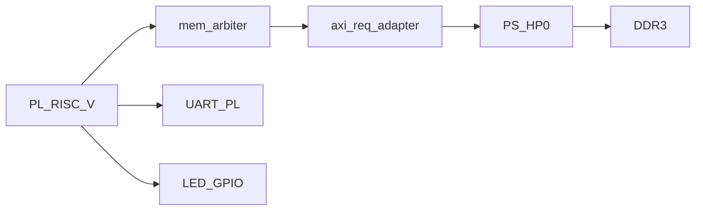

# SUMUD-V FPGA (Zybo Z7-20)

Two bitstream targets:

| Target | Dir | Memory | Purpose |
|--------|-----|--------|---------|
| **#1 Blink** | [`fpga/zybo/`](zybo/) | 64 KiB PL BRAM | LED + UART smoke |
| **#2 PS+DDR** | [`fpga/zybo_ps/`](zybo_ps/) | PS DDR via HP0 | Cache-less DDR memtest |

## Bitstream #1 — PL BRAM (`fpga/zybo`)

| Item | Detail |
|------|--------|
| Top | `fpga_top` |
| Clock | 125 MHz → 50 MHz MMCM |
| Firmware | baked via `$readmemh` (`sw/fpga_blink`) |
| UART | Pmod JB1 @ 115200 |

```bash
make -C sw/fpga_blink
make -C fpga/zybo bitstream
make -C fpga/zybo program
```

Expect UART: `SUMUD-V FPGA blink`.

Sign-off (last measured): 0 Error, WNS ~+1.5 ns @ 50 MHz, ~32% LUT / 16 BRAM.

## Bitstream #2 — PS + DDR (`fpga/zybo_ps`)

PL RISC-V masters **AXI4-Lite → HP0 → DDR**. ARM only for JTAG/DDR init; `cpu_run` GPIO holds the soft core in reset until firmware is loaded.



| Item | Detail |
|------|--------|
| Top | `fpga_top_ps` |
| Clock | PS `FCLK_CLK0` = **50 MHz** |
| CPU view DRAM | `0x8000_0000+` → phys `0x0000_0000+` |
| UART / LED | same MMIO as blink |
| Firmware | **XSCT load** (`sw/fpga_ddr_memtest`) — not in bitstream |

### Host setup

1. Vivado **2025.1** (+ **`xsdb`** from Vivado/bin for `load-fw`; classic `xsct` also works).
2. Digilent board files (required for correct DDR timings):

```bash
git clone --depth 1 https://github.com/Digilent/vivado-boards.git
mkdir -p ~/Xilinx/vivado-boards
cp -a vivado-boards/new/board_files ~/Xilinx/vivado-boards/
# create_project.tcl already sets board.repoPaths to ~/Xilinx/vivado-boards/board_files
```

3. RISC-V GCC (`/opt/riscv`), Zybo JTAG powered.

Digilent PS preset may emit `PCW_UIPARAM_DDR_DQS_TO_CLK_DELAY_*` critical warnings (negative skew) — expected for Zybo Z7-20; ignore if board files are installed.

### Sign-off (bitstream #2, measured)

| Check | Result |
|-------|--------|
| Errors | 0 |
| Timing @ 50 MHz | **Met** — WNS **+1.58 ns** |
| Bitstream | `fpga/zybo_ps/bitstream/sumudv_zybo_ps.bit` (~1.9 MB) |
| `cpu_run` GPIO | `0x41200000` (PS GP0) |

### Build / run

```bash
make -C fpga/zybo_ps bitstream   # BD + synth/impl → bitstream/sumudv_zybo_ps.bit
make -C fpga/zybo_ps program
make -C fpga/zybo_ps load-fw     # DDR load @ 0x0, cpu_run=1
```

UART 115200 on Pmod **JB1** → `SUMUD-V DDR memtest` then **`DDR PASS`**.

While `cpu_run=0`, LD0 heartbeats (core held). After load-fw, LEDs walk on PASS.

### Tree (`zybo_ps`)

```
fpga/zybo_ps/
  bd/create_bd.tcl
  rtl/fpga_top_ps.sv axi_req_adapter.sv mem_arbiter.sv
  constrs/zybo_z7_20_ps.xdc
  tcl/create_project.tcl build_bitstream.tcl program_device.tcl load_fw.tcl
  Makefile
  bitstream/          # generated .bit
```

## Memory map (both targets, CPU view)

| Region | Base | #1 | #2 |
|--------|------|----|----|
| Code/data | `0x8000_0000` | BRAM | DDR (via adapter) |
| UART | `0x1000_0000` | PL | PL |
| GPIO LED | `0x1000_2000` | PL | PL |

## Next milestones

1. Enable `core_cached` on DDR (I$/D$)
2. HDMI colour bars (Digilent RGB2DVI)
3. CPU → framebuffer → DOOM + WAD in DDR
